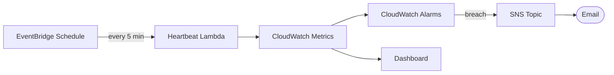

# AWS Observability Stack (Terraform)

> End-to-end monitoring: a scheduled workload, CloudWatch alarms, a dashboard, and SNS alerting — provisioned with Terraform.
> **Author:** Muhammad Ahmad · **IaC:** Terraform · **Cloud:** AWS


---

## 📌 Overview

- A **heartbeat Lambda** runs every 5 minutes (via **EventBridge**) as the monitored workload.
- **CloudWatch alarms** watch its **Errors** and **Duration** metrics.
- A **CloudWatch dashboard** visualizes invocations, errors, and duration.
- Alarms publish to an **SNS topic** (optionally emailed to you).

A compact, reusable monitoring pattern you can point at any workload.

## 🏗️ Architecture

> 🎨 **Interactive diagram (industry-standard icons):** [open in Lucid — page 10](https://lucid.app/lucidchart/3da75ce3-ea66-4296-81b3-00d20a60435b/edit)



## 🚀 Deploy

```bash
cd terraform
terraform init
terraform apply -var="alarm_email=you@example.com"
```

Confirm the SNS subscription email, then open the dashboard output in the CloudWatch console.

## 🧹 Clean up

```bash
terraform destroy
```

## 💰 Cost note

Lambda, EventBridge, and a handful of alarms/dashboards fall largely within the free tier — idle cost is minimal.

## 🔐 Production hardening (next steps)

- Add **composite alarms** and anomaly detection.
- Add **log metric filters** for error patterns.
- Point the alarms at your real services (ALB 5xx, RDS CPU, SQS age).

---

*Built and maintained by **Muhammad Ahmad**.*
