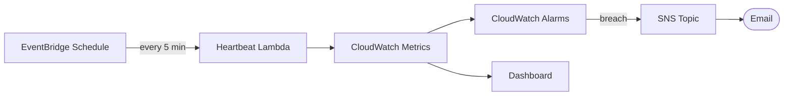

# Architecture Diagram — AWS Observability Stack

## Lucid diagram

- **Master Lucid document (all 30 diagrams, icon style):** https://lucid.app/lucidchart/3da75ce3-ea66-4296-81b3-00d20a60435b/edit
- This project is **page 10** of that document.

## Lucid prompt (reusable)

```
Create an AWS monitoring diagram titled "AWS Observability Stack".
An EventBridge Schedule triggers a Heartbeat Lambda every 5 minutes. The Lambda emits
metrics to CloudWatch. CloudWatch feeds a Dashboard and a set of Alarms; when an alarm
breaches it publishes to an SNS Topic which emails a recipient. Label the arrows.
Clean, professional AWS colors.
```

## Mermaid source


